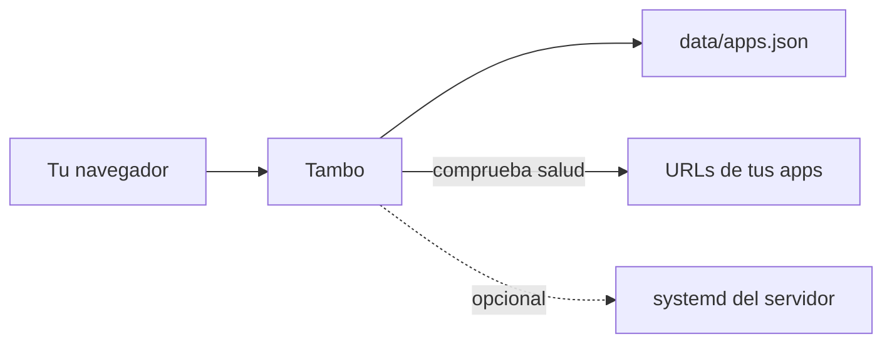

# Tambo

**Tu portal de aplicaciones web, en una sola pantalla.** Agrupa proyectos, busca
entre ellos y comprueba si cada servicio responde. Puedes usarlo para tus
herramientas personales, un equipo pequeño o un entorno de desarrollo.

Tambo lee el catálogo desde `data/apps.json`; las apps siguen ejecutándose en
sus propias direcciones. El portal no las aloja ni reemplaza.

## Qué puedes hacer

- Organizar enlaces por proyecto, fijar favoritos y buscarlos por nombre o tag.
- Ver estados de salud y elegir entre tarjetas compactas o portadas.
- Editar el catálogo desde la interfaz o directamente en JSON; también puedes
  importar y exportar una copia.
- Instalar el portal como PWA en navegadores compatibles.
- Opcionalmente, controlar servicios `systemd --user` y consultar recursos del
  servidor donde corre Tambo.

## Cómo funciona



Las comprobaciones de salud y el control de `systemd` se hacen desde el servidor
de Tambo. Por eso una URL como `http://127.0.0.1:3000/health` apunta al servidor,
no al ordenador de quien abre el portal.

## Inicia Tambo en local

Requisitos: [Bun](https://bun.sh/) 1.4.3 o compatible. Clona este repositorio
y, desde su carpeta raíz, ejecuta:

```bash
cd app
bun install
bun run dev
```

Abre <http://localhost:15170>. El catálogo está en `data/apps.json`, fuera de
`app/`; el servidor lo carga automáticamente. Reemplázalo por tus datos antes
de compartir la instancia. Para detenerla, usa `Ctrl+C` en la terminal.

Comandos útiles desde `app/`:

| Comando | Acción |
| --- | --- |
| `bun run dev` | Inicia el portal para desarrollo |
| `bun run check` | Revisa formato, lint y tipos |
| `bun run test` | Ejecuta las pruebas |
| `bun run build` | Genera la compilación web |

## Añade tus aplicaciones

Puedes usar **Editar** en Tambo o modificar `data/apps.json`. Este ejemplo es
un catálogo mínimo válido; cambia las URLs por las de tus servicios:

```json
{
  "version": 1,
  "settings": {
    "theme": "system",
    "openIn": "newTab",
    "healthIntervalSec": 30
  },
  "groups": [
    {
      "id": "desarrollo",
      "name": "Desarrollo",
      "color": "teal",
      "apps": [
        {
          "id": "mi-dashboard",
          "name": "Mi dashboard",
          "description": "Métricas y actividad del proyecto",
          "url": "https://dashboard.example.com",
          "tags": ["equipo", "prod"],
          "pinned": true,
          "health": { "url": "https://dashboard.example.com/health" }
        }
      ]
    }
  ]
}
```

Cada grupo necesita un `id`, un nombre, un color y una lista de apps. Cada app
necesita un `id`, un nombre y una URL `http` o `https`. `health` es opcional; si
lo omites, Tambo no comprobará el estado de esa app. Los IDs usan minúsculas,
números y guiones, y deben ser únicos. Los colores disponibles son `ember`,
`gold`, `moss`, `teal`, `sky`, `indigo`, `violet` y `rose`.

Al guardar cambios en el archivo, Tambo actualiza la vista automáticamente.
Guarda una copia de `data/apps.json` y de `data/assets/` si añades portadas o
recursos propios.

## Abrirlo desde otros dispositivos

Por defecto, el servidor escucha solo en `127.0.0.1:15170`. Para entrar desde
otro dispositivo, colócalo detrás de un proxy HTTPS en una red privada y permite
el nombre de host que usarás:

```bash
TAMBO_ALLOWED_HOSTS=portal.example.com bun run dev
```

También puedes cambiar el puerto con `TAMBO_PORT`. Cada instalación comparte
un único catálogo entre sus visitantes; **Tambo no incluye inicio de sesión ni
gestión de usuarios**. Mantén el portal en una red de confianza y configura
autenticación en el proxy. La protección de origen de los endpoints no sustituye
esa autenticación. Esto es especialmente importante si habilitas acciones sobre
servicios `systemd`.

## Integración opcional con systemd

En Linux, puedes asociar una app a una unidad de usuario añadiendo su nombre al
objeto de la app:

```json
"service": "mi-dashboard.service"
```

El servidor debe ejecutarse bajo el mismo usuario que posee esa unidad. Tambo
puede encenderla o detenerla desde la interfaz y, en Linux con cgroups v2,
mostrar su uso de CPU y memoria. Si usas Sablier, también puede solicitar el
despertar de una app dormida y mostrar su sesión. Deja estas opciones fuera del
catálogo si no necesitas controlar procesos del servidor.

## Detalles técnicos

- Interfaz: React, TypeScript y Vite+ (`app/`).
- Configuración validada con Zod (`app/src/schema.ts`).
- Datos y portadas: `data/`.
- API local: `/api/config`, `/api/health` y `/api/services`.
- `compose.yaml` y `caddy/` contienen el despliegue Docker/Caddy de este
  repositorio; revisa y adapta red, dominios, TLS y permisos antes de reutilizarlo.

## Licencia

Este repositorio no incluye actualmente un archivo `LICENSE`. Su propietario
debe añadir una licencia antes de conceder permisos de redistribución o uso
comercial.
